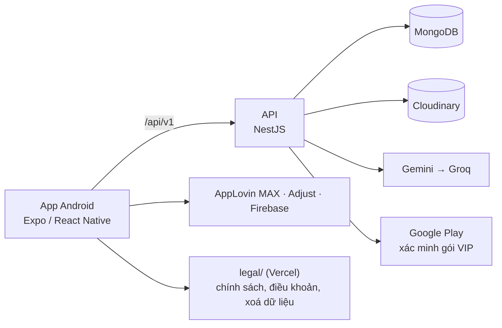

# PalmSight

Ứng dụng Android xem chỉ tay bằng AI. Người dùng chọn trường phái (phương Tây, phương Đông, Ấn Độ), chọn các mục muốn xem, chụp hoặc chọn ảnh lòng bàn tay, và nhận bài luận giải do AI (Gemini, dự phòng Groq) viết. Kết quả chỉ mang tính giải trí.

**Chỉ có app Android.** Không có bản web và không có đăng nhập: mỗi thiết bị là một tài khoản, tạo tự động khi mở app. Repo này là nguồn duy nhất cho app, backend và các trang chính sách.

> Các trang trong `legal/` (chính sách riêng tư, điều khoản, xoá dữ liệu) là **bản nháp**: còn các chỗ `[ĐIỀN]` và `[XÁC NHẬN]`, cần chủ app và tư vấn pháp lý duyệt trước khi đăng.

## Tính năng

- **GEM**: mỗi lần xem tốn 5 GEM, tự hoàn nếu AI lỗi hoặc ảnh không phải lòng bàn tay. Tài khoản mới nhận 5 GEM khởi đầu (mỗi thiết bị một lần).
- **Kiếm GEM**: điểm danh theo chuỗi (3, 3, 5, 3, 3, 8, 10 GEM, kèm thưởng mốc ở ngày 30, 60, 100, 180, 270, 365), vòng quay (giải 2, 3, 5, 10, 20, 50 GEM), quảng cáo có thưởng (+3 GEM, tối đa 5 lần mỗi ngày), mã giới thiệu (người nhập +5, người mời +3).
- **VIP** qua Google Play (gói tuần, tháng, năm): mở trường phái Phương Đông và Ấn Độ, không banner, quảng cáo xen kẽ và quảng cáo gốc, +50 GEM mỗi ngày (mỗi thiết bị một lần mỗi ngày).
- **Xoá tài khoản ngay trong app** (Hồ sơ &gt; Xoá tài khoản), xoá riêng từng lần xem.
- 9 ngôn ngữ trong app: en, vi, id, hi, zh, ru, ja, pt, es.
- Quảng cáo AppLovin MAX; đo lường Adjust, Firebase Analytics và Crashlytics chỉ bật ở khu vực ngoài phạm vi GDPR.

## Tech stack

| Lớp | Công nghệ |
| --- | --- |
| App | Expo / React Native (Android), expo-router, AppLovin MAX, Adjust, Firebase, react-native-iap |
| Backend | NestJS 11 (Node 22), Mongoose, MongoDB 7 |
| Dùng chung | `shared/`: DTO, enum, hằng số kinh tế, schema Yup |
| AI | Google Gemini (chính), Groq (dự phòng); vẽ đường chỉ tay bằng `palm-service` (MediaPipe + ONNX) |
| Ảnh | `sharp` xoá EXIF trong bộ nhớ, lưu ảnh của lần xem thành công trên Cloudinary |
| Trang chính sách | HTML tĩnh trong `legal/`, phát hành trên Vercel |
| Deploy backend | Render (`render.yaml`, service `boi-qvgy`), MongoDB Atlas |
| Dev | pnpm workspaces, Docker Compose (MongoDB replica set) |

## Kiến trúc



## Chạy local

Yêu cầu: Node 22, pnpm 9, Docker, API key Gemini/Groq, tài khoản Cloudinary (tuỳ chọn khi dev: thiếu thì ảnh lưu dạng base64 trong DB), Android emulator hoặc máy thật.

```bash
git clone <repo-url> palmsight && cd palmsight
cp backend/.env.example backend/.env   # điền giá trị, không commit
pnpm install
docker compose up -d
pnpm --filter backend db:sync-indexes
pnpm --filter backend dev              # API ở :4000
pnpm start:mobile2                     # Metro ở :8081
```

Chi tiết: [docs/getting-started.md](docs/getting-started.md) và [mobile-2/README.md](mobile-2/README.md).

## Cấu trúc thư mục

```text
palmsight/
├─ backend/    # NestJS API, scripts vận hành (users:delete, db:check, credits:reconcile)
├─ mobile-2/   # app Android (Expo)
├─ shared/     # @palmsight/shared
├─ palm-service/ # Python: MediaPipe + model ONNX vẽ đường chỉ tay (không thuộc pnpm workspace)
├─ legal/      # trang chính sách tĩnh cho Vercel
├─ docs/       # tài liệu
├─ render.yaml · docker-compose.yml · Dockerfile
└─ .github/    # CI, template issue / PR
```

`frontend/` (web cũ) đã bị bỏ khỏi workspace; thư mục còn lại trên đĩa sẽ do chủ app xoá.

## Tài liệu

| Tài liệu | Nội dung |
| --- | --- |
| [docs/README.md](docs/README.md) | Mục lục và tổng quan |
| [docs/business-rules.md](docs/business-rules.md) | Quy tắc GEM, VIP, giới thiệu, xoá tài khoản |
| [docs/workflow.md](docs/workflow.md) | Luồng mở app, xem bói, mua VIP, xoá tài khoản |
| [docs/api-contract.md](docs/api-contract.md) | REST API |
| [docs/database-erd.md](docs/database-erd.md) | Collection MongoDB, dữ liệu giữ và xoá khi xoá tài khoản |
| [docs/ai-integration.md](docs/ai-integration.md) | Gemini/Groq, trường phái, prompt, schema kết quả |
| [docs/security-privacy.md](docs/security-privacy.md) | Bảo mật, quyền riêng tư, lưu trữ |
| [docs/screens.md](docs/screens.md) | Màn hình của app |
| [docs/testing.md](docs/testing.md) | Kiểm thử |
| [docs/deployment.md](docs/deployment.md) | Triển khai |
| [docs/MONETIZATION_PLAYBOOK.md](docs/MONETIZATION_PLAYBOOK.md) | Kế hoạch kiếm tiền và quảng cáo |
| [docs/CONSISTENCY_PLAN.md](docs/CONSISTENCY_PLAN.md) | Kế hoạch thống nhất sau khi bỏ web |

`docs/PRODUCT_BACKLOG_ROADMAP.md`, `docs/roadmap.md` và `docs/mobile-guest-onboarding-log.md` là tài liệu lịch sử. Thư mục `docs/adr/` không có trong repo, nên mọi tham chiếu ADR trong tài liệu cũ không còn đích.

## Đóng góp

Xem [CONTRIBUTING.md](CONTRIBUTING.md). Báo lỗ hổng bảo mật theo [SECURITY.md](SECURITY.md), không mở issue công khai.

## Miễn trừ

Kết quả bói chỉ mang tính giải trí, không thay thế tư vấn y tế, tài chính hay pháp lý.

## License

Chưa có license. Theo mặc định của GitHub, khi repo không có file `LICENSE`, người khác được xem code nhưng không được phép dùng lại.
