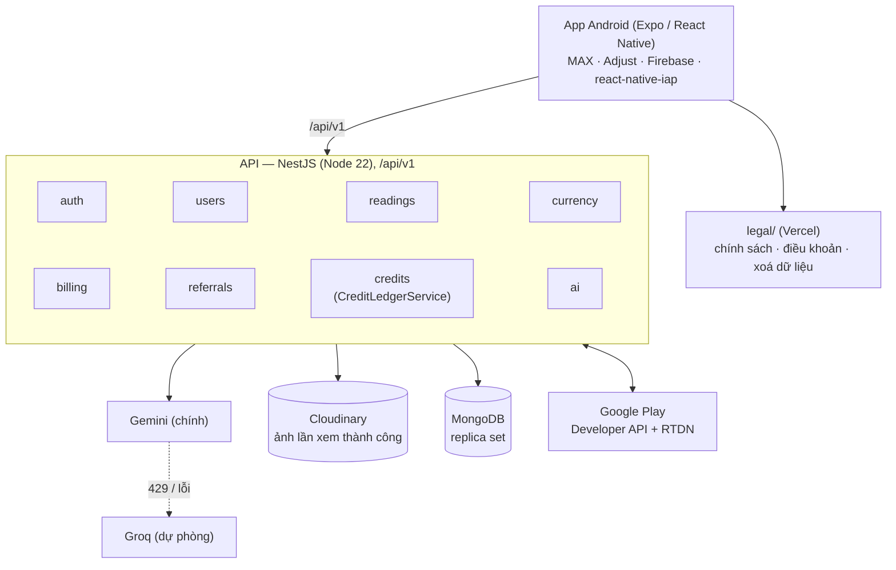

# PalmSight — Tài liệu dự án

Cập nhật: 2026-11-05

Giới thiệu repo và cách chạy: [../README.md](../README.md). Quy tắc đóng góp: [../CONTRIBUTING.md](../CONTRIBUTING.md).

**Hướng sản phẩm: chỉ có app Android, không có web, không đăng nhập.** Mỗi thiết bị là một tài khoản tạo tự động. Các file đánh dấu "lịch sử" bên dưới viết cho bản web cũ và không còn là nguồn sự thật.

| File | Nội dung |
| --- | --- |
| [business-rules.md](business-rules.md) | Quy tắc GEM, xem bói, VIP, giới thiệu, quảng cáo, xoá tài khoản |
| [workflow.md](workflow.md) | Luồng mở app, xem bói, kiếm GEM, mua VIP, xoá tài khoản |
| [api-contract.md](api-contract.md) | REST API theo controller hiện tại |
| [database-erd.md](database-erd.md) | Collection MongoDB; dữ liệu xoá và giữ khi xoá tài khoản |
| [ai-integration.md](ai-integration.md) | Gemini/Groq, trường phái, chọn mục, prompt, schema kết quả |
| [security-privacy.md](security-privacy.md) | Phiên, băm định danh, xử lý ảnh, đồng ý, quyền, bí mật |
| [screens.md](screens.md) | Màn hình của app |
| [testing.md](testing.md) | Cách chạy kiểm tra và các nhóm ca test |
| [getting-started.md](getting-started.md) | Cài đặt và chạy local |
| [deployment.md](deployment.md) | Hạ tầng, biến môi trường, quy trình deploy, vận hành |
| [MONETIZATION_PLAYBOOK.md](MONETIZATION_PLAYBOOK.md) | Kế hoạch kiếm tiền, quảng cáo, paywall (tiếng Anh) |
| [CONSISTENCY_PLAN.md](CONSISTENCY_PLAN.md) | Kế hoạch thống nhất sau khi bỏ web, trạng thái từng nhóm việc, phụ lục bằng chứng |
| [PRODUCT_BACKLOG_ROADMAP.md](PRODUCT_BACKLOG_ROADMAP.md), [roadmap.md](roadmap.md), [mobile-guest-onboarding-log.md](mobile-guest-onboarding-log.md), [DESIGN.md](DESIGN.md) | **Lịch sử** (bản web, credits, đăng nhập) |

Tài liệu của app: [../mobile-2/README.md](../mobile-2/README.md). Trang chính sách công khai (bản nháp): `../legal/`. Thư mục `docs/adr/` không có trong repo; mọi liên kết ADR trong tài liệu lịch sử không còn đích.

## Tổng quan

PalmSight là app Android xem chỉ tay bằng AI: chọn trường phái (phương Tây, phương Đông, Ấn Độ), chọn mục, chụp hoặc chọn ảnh lòng bàn tay và nhận bài luận giải do AI viết. Mỗi lần xem tốn 5 GEM. Kết quả mang tính giải trí; app phải hiển thị câu miễn trừ này ở mọi trang kết quả.

**Trong phạm vi**

- Phiên khách theo thiết bị, GEM (quà khởi đầu, điểm danh, vòng quay, quảng cáo có thưởng, mã giới thiệu), VIP qua Google Play, quảng cáo AppLovin MAX.
- Xem bói bằng Gemini (dự phòng Groq); ảnh của lần xem thành công lưu trên Cloudinary.
- Lịch sử lần xem và lịch sử GEM; xoá từng lần xem; xoá tài khoản trong app.
- 9 ngôn ngữ trong app (en, vi, id, hi, zh, ru, ja, pt, es).

**Ngoài phạm vi**

- Bản web, đăng ký/đăng nhập, quên mật khẩu, OAuth, email.
- Vẽ đường chỉ tay bằng ONNX (đã nằm trong bản web cũ).
- iOS, trang admin, so sánh hai bàn tay.

## Kiến trúc

Mọi thay đổi nghiệp vụ (GEM, giới thiệu, trường phái, API, schema MongoDB) phải sửa tài liệu tương ứng trong cùng PR.
