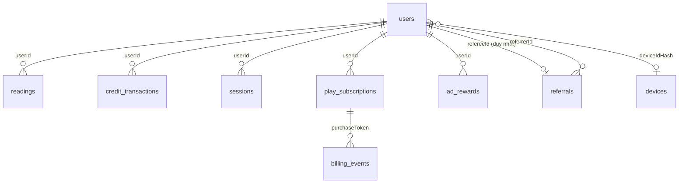

# database-erd — MongoDB

Database `boi` trên MongoDB (Atlas khi deploy, replica set khi chạy local vì cần transaction). Schema nằm trong `backend/src/schemas/`; chỉ mục được tạo bằng `pnpm --filter backend db:sync-indexes`.

## Collection

| Collection | Nội dung chính | Chỉ mục / hạn |
| --- | --- | --- |
| `users` | `displayName`, `username?`, `avatarUrl/avatarPublicId`, `creditBalance`, `referralCode`, `referralBlocked`, `isAnonymous`, `deviceIdHash`, `deletedDeviceIdHash`, `signupIpHash`, `vipExpiresAt/vipProductId/vipWillRenew`, `billingRef`, `starterGrantedAt`, `checkinDay/checkinStreak/lastCheckinAmount`, `freeSpinDay`, `vipDailyDay`, `deletedAt` | `deviceIdHash` duy nhất (một phần, chỉ khi là chuỗi) |
| `devices` | một dòng mỗi `deviceIdHash`: dấu quà khởi đầu (`starterGrantedAt/UserId/IpHash`), điểm danh, vòng quay, quà VIP hằng ngày (`vipDailyDay/vipDailyUserId`), lần nhập mã giới thiệu | `deviceIdHash` duy nhất |
| `readings` | `userId`, `idempotencyKey`, `school`, `topics`, `hand`, `status` (PROCESSING/DONE/REJECTED/FAILED), `result`, `imageUrl/imagePublicId`, `annotatedImageUrl/annotatedImagePublicId`, `palmLines`, `rejectReason`, `aiProvider/aiModel`, `errorCode`, `latencyMs`, `completedAt`, `deletedAt` | `(userId, createdAt)`, `(status, createdAt)`, khoá idempotency theo user |
| `credit_transactions` | sổ GEM: `amount`, `type`, `balanceAfter`, `readingId?`, `referralId?`, `adClaimId?`, `note?` | `(userId, _id)` và các chỉ mục chống ghi trùng |
| `referrals` | `referrerId`, `refereeId`, `codeUsed`, `status`, `referrerReward` | `refereeId` duy nhất |
| `referral_network_counters` | bộ đếm mạng theo `ipHash` và ngày | TTL `expiresAt` (2 ngày) |
| `ad_rewards` | vé thưởng quảng cáo: `kind` (checkin/spin/bonus), `status`, `rewardDay`, `amount`, `deviceIdHash` | TTL `purgeAt` (48 giờ) |
| `play_subscriptions` | `purchaseToken`, `productId`, `orderId`, `expiresAt`, `willRenew`, `isTrial`, giá, `acknowledged`, `supersededBy`, `firstPurchaseCounted`; dữ liệu cũ còn `gaid`, `adjustAdid`, `rawResponse` (server không còn ghi) | `purchaseToken` duy nhất |
| `billing_events` | RTDN đã xử lý: `eventId`, `purchaseToken`, `notificationType`, `productId`, `payload` | `eventId` duy nhất |
| `sessions` | `refreshTokenHash`, `expiresAt` (30 ngày), `revokedAt` | `refreshTokenHash` duy nhất, TTL `expiresAt` |
| `deleted_identities` | HMAC của định danh đã xoá (`kind`, `valueHmac`, `deletedAt`) để tài khoản tạo lại không nhận quà | `valueHmac` duy nhất |

Dữ liệu cũ của bản web có thể còn trong DB (`guest_trials`, `password_resets`, `pending_registrations`, lần xem khách không có `userId`). Code hiện tại không đọc các collection này; cần dọn riêng sau khi chủ app xác nhận.

## Băm định danh

- `deviceIdHash` = HMAC-SHA256(`IDENTITY_HASH_SECRET`, `device:` + định danh thiết bị).
- Mã băm IP = HMAC-SHA256(`IDENTITY_HASH_SECRET`, `ip:` + IP). Đổi secret làm mất khả năng khớp với dữ liệu cũ.
- `deleted_identities.valueHmac` = HMAC-SHA256 của email hoặc `provider:id` (chỉ còn tác dụng với tài khoản cũ có email/Google/Facebook).

## Khi xoá tài khoản (`deleteUserAccount`)

Ảnh trên Cloudinary (ảnh các lần xem và ảnh đại diện) được xoá trước; lỗi thì không đổi gì trong DB. Sau đó, trong một transaction:

| Collection | Bị xoá hoặc ẩn | Được giữ |
| --- | --- | --- |
| `users` | tên hiển thị (thành "Người dùng đã xoá"), `username`, `email`, mật khẩu, `identities`, ảnh đại diện, `signupIpHash`, `billingRef`, trạng thái VIP, ngày điểm danh/vòng quay/quà VIP | `_id`, `referralCode`, `deviceIdHash`, `creditBalance`, `referralBlocked`, thời điểm tạo, `deletedAt` |
| `readings` | `result`, `palmLines`, `rejectReason`, URL và publicId ảnh, `topics` (thành `[]`) | khung metadata: `school`, `hand`, `status`, `aiProvider/aiModel`, thời điểm, `deletedAt` |
| `sessions` | xoá hết | không |
| `credit_transactions` | `note` | `amount`, `type`, `balanceAfter` và các liên kết (sổ GEM vẫn khớp) |
| `devices` | `starterIpHash` | dấu quà khởi đầu, điểm danh, vòng quay, quà VIP hằng ngày, lần nhập mã giới thiệu (để chống farm) |
| `play_subscriptions` | `gaid`, `adjustAdid`, `rawResponse` | `purchaseToken`, `orderId`, `productId`, hạn, giá, `userId` (đối soát hoá đơn) |
| `billing_events` | `payload` | `eventId`, loại thông báo, `purchaseToken` |
| `deleted_identities` | không | thêm HMAC email/định danh đăng nhập nếu tài khoản cũ có |
| `referrals`, `ad_rewards`, `referral_network_counters` | không đụng | giữ nguyên (chống farm); `ad_rewards` và bộ đếm tự hết hạn |

**Giữ nhưng chưa có cơ chế tự xoá** (cần chủ app chốt thời hạn, xem mục 6 của chính sách riêng tư): bản ghi `users` rút gọn, `devices`, `deleted_identities`, `credit_transactions`, `referrals`, `play_subscriptions` (đề xuất 10 năm), `billing_events`, khung metadata của `readings`; mã băm thiết bị và định danh (đề xuất 5 năm). Hiện chỉ `sessions`, `ad_rewards` và `referral_network_counters` có TTL.

`play_subscriptions` còn giữ `purchaseToken` sau khi xoá tài khoản nên người dùng có thể khôi phục VIP lên tài khoản mới (chủ app đã chọn giữ hành vi này).
